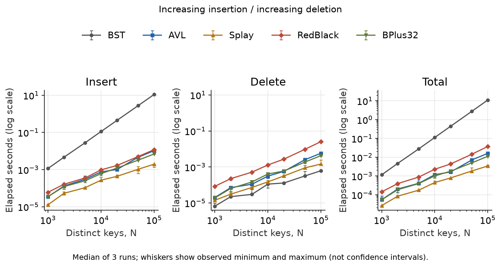
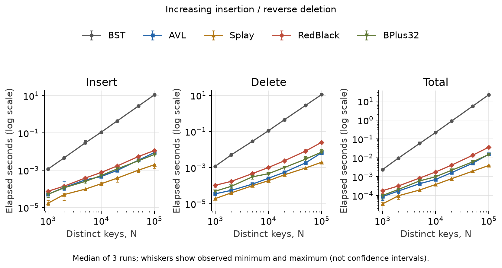
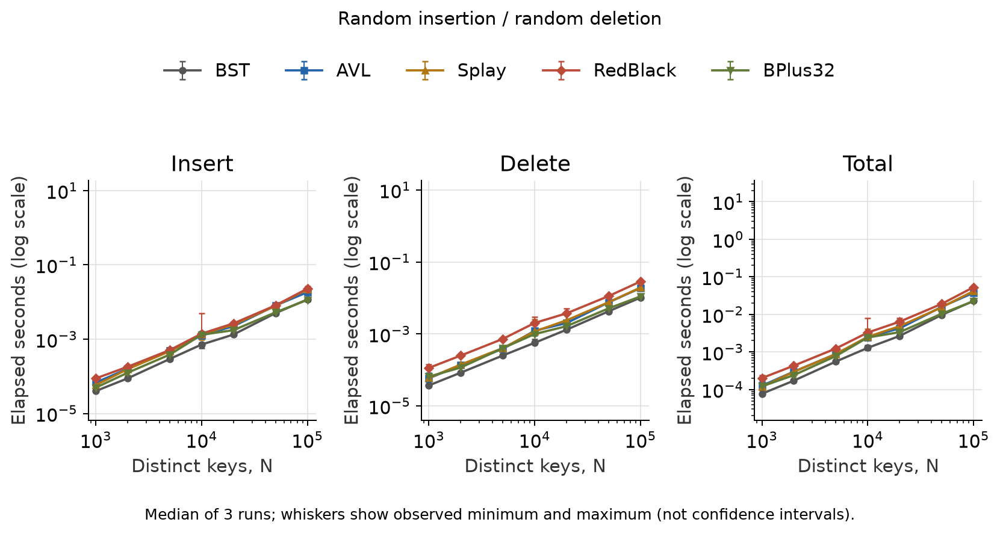

# Compare Search Trees

Author: YiFeng Zheng
YuJie Sun

Group number: 17

Date: 2026-10-21

## Abstract

This report investigates the performance of five search trees on sequences of insertions and deletions: unbalanced binary search trees, AVL trees, splay trees, red-black trees, and B+ trees. Correctness is checked by an insertion/deletion smoke test for each tree, run under memory and undefined-behavior sanitizers. Each configuration has one warmup and ten measured runs. Ordered BST insertion exhibits quadratic growth, while balanced and adaptive trees avoid that total-cost behavior. Phase-separated plots reveal the benefits of splaying on ordered sequences. All programs are implemented in C.

# Introduction

## Background and Objectives

A search tree represents an ordered set while supporting insertion, deletion, and membership queries. The same set can have very different update costs because its representation depends on balance rules and access order. 
This project compares an unbalanced binary search tree (BST), an AVL tree, a splay tree, a red-black tree, and a B+ tree using the three update sequences.

## Problem Statement

For each size N, the keys are the N distinct integers from 0 through N-1. The experiment inserts every key into an empty tree and then deletes every key. 
1. Scenario 1 inserts in increasing order and deletes in increasing order; 
2. Scenario 2 inserts in increasing order and deletes in decreasing order;
3. Scenario 3 uses separately shuffled insertion and deletion permutations. The measured sizes are 1,000, 2,000, 5,000, 10,000, 20,000, 50,000, and 100,000.

# Data Structure / Algorithm Specification

## Unbalanced Binary Search Tree

As introduced in FDS, a binary search tree is a rooted binary tree in which each node's key is greater than every key in its left subtree and less than every key in its right subtree [1].

We use an unbalanced BST as the baseline to highlight the balancing properties of the other trees.

Our C implementation inserts and deletes iteratively. Insertion attaches a new leaf; deletion bypasses a node with at most one child or replaces a two-child node's key with its inorder successor [1]. Updates perform no balancing rotations.

## AVL Tree

An AVL tree is a BST whose left and right subtree heights differ by at most one at every node [2].

Insertion adds a leaf along the BST search path. Deletion replaces a node with its only child, or with NULL if it is a leaf. For two children, it copies the inorder successor's key and deletes that successor. Both operations call `AvlBalance` while returning up the tree.

Let $b(T)=h(T_L)-h(T_R)$. If $b(T)>1$, rotate right; first rotate the left child left if its balance is negative. If $b(T)<-1$, rotate left; first rotate the right child right if its balance is positive. A child balance of zero uses a single rotation. After rotation, update the old root's height, then the new root's height. Return the new subtree root and continue checking ancestors.

## Splay Tree

A splay tree is a self-adjusting BST that moves an accessed node to the root through rotations [3].

Its distinguishing feature is access-driven restructuring, without a fixed balance constraint.

The C code uses top-down splaying: zig-zig rotations shorten repeated-direction paths, while smaller and larger keys are collected separately and reassembled around the accessed root [3]. Insertion makes the new key the root; deletion joins the subtrees by splaying the left subtree's maximum. Membership checks are read-only and do not splay.

## Red-Black Tree

A red-black tree is a BST with a black root, no two red nodes in a row, and the same number of black nodes on each path to a null leaf [1]. Our code uses a left-leaning red-black tree; null links count as black.

Insertion adds a red leaf. On return, `RedBlackBalance` checks in order: rotate left for a red right link; rotate right for red left and left-left links; flip colors when both child links are red. A color flip changes the parent and both children to the opposite color. Finally, color the root black.

Deletion first checks that the key exists. If both root children are black, color the root red before these steps:

1. Going left: if the left and left-left links are black, call `MoveRedLeft`. Flip colors; if the right-left link is red, rotate the right child right, rotate the current node left, and flip colors again.
2. Otherwise: rotate right if the left link is red. Remove a matching node with no right child. If the right and right-left links are black, call `MoveRedRight`: flip colors, then rotate right and flip again if the left-left link is red.
3. Replace a matching key with its successor and use `DeleteMin` to remove the successor; otherwise, continue right. `DeleteMin` uses step 1 before going left. On return, call `RedBlackBalance`. Color the remaining root black.

## B+ Tree

A B+ tree stores records in linked leaves at the same depth and uses keys in internal nodes to choose a child [4]. Our non-root nodes hold 16 to 32 records or child pointers. Each separator is the minimum key of the child on its right.

Insertion shifts leaf records to add the key. A node with 33 entries splits into 16 and 17; the parent adds the new child. Splits continue upward if needed. A root split creates a new root with two children.

Deletion removes the record. If a child has fewer than 16 entries, try borrowing the left sibling's last entry; if that fails, try the right sibling's first entry. A sibling can lend only if it has more than 16 entries. If neither can lend, merge with the left sibling if available, otherwise the right. Remove one parent pointer and check the parent on return. Leaves move records; internal nodes move child pointers. `Refresh` updates separators, and leaf splits and merges update `Next`. Replace a one-child root with its child; remove an empty leaf root.

## Correctness Argument

An empty tree is correct. Assume the tree is correct before an update. BST deletion uses the right subtree's smallest key when replacing a node with two children, so keys stay in order [1]. Rotations also keep this order; AVL and red-black repairs restore their balance rules [1], [2]. Splay deletion joins the left and right trees only when all left keys are smaller [3]. B+ splits, borrowing, and merges keep records in order and within node limits; updated separator keys keep searches correct [4]. These steps add or remove only the requested key, so each update leaves a correct tree. By induction, this holds for the whole sequence. Tests check some cases but do not prove all cases.

# Testing Results

## Environment and Timing Methodology

The experiment was conducted in the following environment.

| Item | Configuration |
| --- | --- |
| Experiment date | 2026-10-21 |
| CPU | AMD Ryzen 7 H 255 W/ Radeon 780M |
| Operating system | WSL2; Linux 6.6.87.2-microsoft-standard-WSL2; x86-64 |
| Compiler | gcc (Ubuntu 13.3.0-6ubuntu2~24.04.1) 13.3.0 |
| Build flags | -std=c11 -O2 -Wall -Wextra -Wpedantic |
| Timer | POSIX CLOCK_MONOTONIC, elapsed wall time |
| Repetitions | 1 warmup + 10 measured runs per scenario / size / tree |
| Execution | One process; sequential; no CPU affinity |
| B+ capacity | 32 leaf records or 32 internal children |

For Scenario 3, two arrays start with keys 0 through $N-1$. Fisher-Yates shuffles each array: for $i$ from $N-1$ down to 1, swap entry $i$ with a random entry from 0 through $i$. The random indices come from xorshift32 through `BoundedRandom`. A fixed seed formula uses $N$ and the repetition number. The insertion array is shuffled first, then the deletion array without resetting the generator. Each key appears once in each array. All trees share these arrays; the seed and both orders are saved.

Each warmup runs the full insertion and deletion sequence and is left out of the results. Tree order rotates across runs. Input output and checks are outside timing. Allocation and freeing are included.

These timings replace the earlier three-run results. The new run has not yet been checked by the other group member.

## Smoke Test

Observed smoke test results.

| Test case | Type | Expected / actual result |
| --- | --- | --- |
| Deleting from an empty tree | Boundary | Accepted, no change; PASS for all five trees |
| INT_MIN and INT_MAX; 1,000 increasing keys | Functional | Both boundary keys found; sampled keys found; an absent key reported absent |
| Full insert-then-delete cycle | Functional | Every key accepted, then removed; NULL root afterwards; PASS |
| Same cycle under ASan and UBSan | Memory / undefined behavior | No sanitizer diagnostics; PASS |
| All 1,050 timed trials, N up to 100,000 | Large-scale | Sampled keys present after insertion; NULL root after deletion; PASS |

README.md documents how to reproduce every result in this chapter. The smoke test checks sampled membership and a full deletion cycle; it does not replace those structural checks.

## Runtime Tables

- Times are in milliseconds (ms); N is the number of keys.
- Each value is the median total insertion-plus-deletion time of ten runs.

### Increasing insertion / increasing deletion

Increasing insertion / increasing deletion: median total elapsed time (ms).

| N | BST | AVL | Splay | RedBlack | BPlus32 |
| --- | --- | --- | --- | --- | --- |
| 1,000 | 2.149 | 0.100 | 0.049 | 0.289 | 0.111 |
| 2,000 | 8.610 | 0.287 | 0.159 | 0.642 | 0.257 |
| 5,000 | 53.274 | 0.912 | 0.430 | 2.026 | 0.879 |
| 10,000 | 164.166 | 1.373 | 0.510 | 3.021 | 1.223 |
| 20,000 | 566.240 | 2.365 | 0.941 | 6.211 | 2.887 |
| 50,000 | 3580.839 | 10.540 | 3.160 | 22.409 | 7.436 |
| 100,000 | 14125.182 | 15.582 | 4.662 | 42.506 | 14.330 |

### Increasing insertion / reverse deletion

Increasing insertion / reverse deletion: median total elapsed time (ms).

| N | BST | AVL | Splay | RedBlack | BPlus32 |
| --- | --- | --- | --- | --- | --- |
| 1,000 | 4.359 | 0.167 | 0.058 | 0.289 | 0.164 |
| 2,000 | 17.282 | 0.314 | 0.153 | 0.626 | 0.320 |
| 5,000 | 95.568 | 0.700 | 0.463 | 1.642 | 1.069 |
| 10,000 | 282.964 | 1.307 | 0.513 | 2.378 | 1.447 |
| 20,000 | 1136.756 | 2.410 | 1.013 | 5.952 | 3.009 |
| 50,000 | 7040.576 | 8.018 | 2.516 | 18.855 | 8.788 |
| 100,000 | 28626.761 | 17.897 | 4.919 | 42.303 | 17.921 |

### Random insertion / random deletion

Random insertion / random deletion: median total elapsed time (ms).

| N | BST | AVL | Splay | RedBlack | BPlus32 |
| --- | --- | --- | --- | --- | --- |
| 1,000 | 0.183 | 0.332 | 0.284 | 0.467 | 0.257 |
| 2,000 | 0.350 | 0.600 | 0.572 | 0.812 | 0.478 |
| 5,000 | 0.839 | 1.370 | 1.473 | 2.053 | 1.174 |
| 10,000 | 1.664 | 2.987 | 2.480 | 3.615 | 1.927 |
| 20,000 | 3.864 | 5.887 | 6.384 | 8.525 | 4.583 |
| 50,000 | 11.038 | 18.561 | 20.512 | 26.303 | 12.713 |
| 100,000 | 31.499 | 46.491 | 52.260 | 73.465 | 32.181 |

## Runtime Plots

- Panels show insertion, deletion, and total time.
- Axes show N and seconds, both on logarithmic scales.
- Colors and markers identify trees; points show ten-run medians and error bars show the minimum and maximum.

# Analysis and Comments

## Time Complexity

The full sequence consists of N insertions followed by N deletions. Bounds are worst-case unless marked as amortized; the B+ tree capacity is fixed at 32.

BST updates take time proportional to tree height [1]. AVL and red-black balancing maintain logarithmic height [1], [2]; fixed-capacity B+ trees also have logarithmic height [4]. Splay operations have an O(log N) amortized bound [3]. Applying these bounds to the 2N updates gives the full-sequence bounds below.

| Tree | Single insertion or deletion | Full sequence |
| --- | --- | --- |
| BST | O(N) | O(N^2) |
| AVL | O(log N) | O(N log N) |
| Splay | O(N); O(log N) amortized | O(N log N) |
| Red-Black | O(log N) | O(N log N) |
| B+ (capacity 32) | O(log N) | O(N log N) |

### Why Sorted BST Updates Are Quadratic

Increasing insertion creates a right chain in the plain BST. Using the height-based update bound [1], the ith insertion visits i−1 nodes, giving N(N−1)/2 visits and Θ(N²) time. 
At the same time, increasing deletion removes the root each time and takes Θ(N) in total. Reverse deletion searches the remaining chain each time and takes Θ(N²). Thus, both scenarios have quadratic total cost, but different deletion costs.

### Why Splay Benefits from Ordered Updates

With increasing insertions, the largest key stays at the root, so each insertion takes constant time. The tree may become a left chain, but the total insertion cost is still O(N). 
Deleting in reverse order also takes O(N): each deletion removes the maximum at the root and exposes its left subtree. 
Increasing deletions behave differently. The first deletion must traverse the left chain to reach the minimum, costing Θ(N), so not every deletion is constant-time. However, the general amortized theorem gives O(N log N) for the full update sequence [3].

## Space Complexity

| Tree | Total tree space | Update auxiliary space |
| --- | --- | --- |
| BST | O(N) | O(1) |
| AVL | O(N) | O(log N) |
| Splay | O(N) | O(1) |
| Red-Black | O(N) | O(log N) |
| B+ (capacity 32) | O(N) | O(log N) |

All five trees use linear storage. Auxiliary space is constant for iterative updates and logarithmic for the recursive update stacks in these implementations.

## Measured Comparison

At N = 100,000, Splay has the lowest median in both ordered tests (4.662 and 4.919 ms). In the random test, BST takes 31.499 ms and BPlus32 takes 32.181 ms, about 2.2% apart. Their ranges are 27.808–43.305 ms and 25.349–39.503 ms. These results show close performance, not a stable winner.

- Random BST: shuffled insertion avoids the fixed chain caused by sorted keys. Our iterative code has no height updates, color changes, or rotations. Less extra work helps explain its low times, but it does not guarantee short paths.
- AVL and RedBlack: AVL updates heights and rotates when needed. RedBlack first searches for the key, then starts again from the root to delete it. It also changes colors and links on the way down and checks balance on return. This extra work may explain why it is slower here.
- BPlus32: more children per node mean fewer levels. Keys stored together may help cache use. However, scanning and shifting entries, refreshing separators, and splitting or merging nodes also take time. These costs help explain why it does not always beat AVL. Disk access and leaf-chain scans are not part of this test.

These are code-based explanations, not measured cost breakdowns. We did not count node visits, rotations, or cache misses, and the results do not give a general ranking of the trees.

## Limitations and Improvements

- Statistics: ten runs on one machine; system load and random inputs can affect small differences.
- Workloads: only build-then-delete integer tests; add mixed operations and search benchmarks.
- Page I/O: this in-memory benchmark does not measure disk access; test a disk-backed B+ tree.

## Conclusion

The results show that operation order affects tree performance. 
Sorted insertions turn a plain BST into a chain, giving quadratic total time. AVL and red-black trees maintain logarithmic height through balancing. 
At N = 100,000, Splay has the lowest median in both ordered tests. BST and BPlus32 are close in the random test, with BST slightly faster by median. The best choice depends on the workload and the code used.

# References

[1] R. Sedgewick and K. Wayne, *[Algorithms](https://algs4.cs.princeton.edu/home/)*, 4th ed. Boston, MA, USA: Addison-Wesley, 2011, secs. 3.2-3.3.

[2] M. A. Weiss, *[Data Structures and Algorithm Analysis in C++](https://www.pearson.com/en-us/subject-catalog/p/data-structures-and-algorithm-analysis-in-c/P200000003459/9780135340066)*, 4th ed. Upper Saddle River, NJ, USA: Pearson, 2014, sec. 4.4.

[3] D. D. Sleator and R. E. Tarjan, “[Self-adjusting binary search trees](https://www.cs.cmu.edu/~sleator/papers/Self-Adjusting.htm),” *J. ACM*, vol. 32, no. 3, pp. 652-686, Jul. 1985, doi: [10.1145/3828.3835](https://doi.org/10.1145/3828.3835).

[4] A. Silberschatz, H. F. Korth, and S. Sudarshan, *[Database System Concepts](https://www.db-book.com/)*, 7th ed. New York, NY, USA: McGraw-Hill, 2019, ch. 14.

# Author List

## Division of Work
YiFeng Zheng: Implemented the programs, conducted the tests, and wrote the report.
YuJie Sun: Reproduced the earlier tests and reviewed the report.

# Declaration
We hereby declare that all work in this project, titled “Compare Search Trees,” is our
independent effort as a group.

# Signatures
YiFeng Zheng
YuJie Sun

# Source Code Appendix
The full source code is provided in the accompanying `code/` directory.
